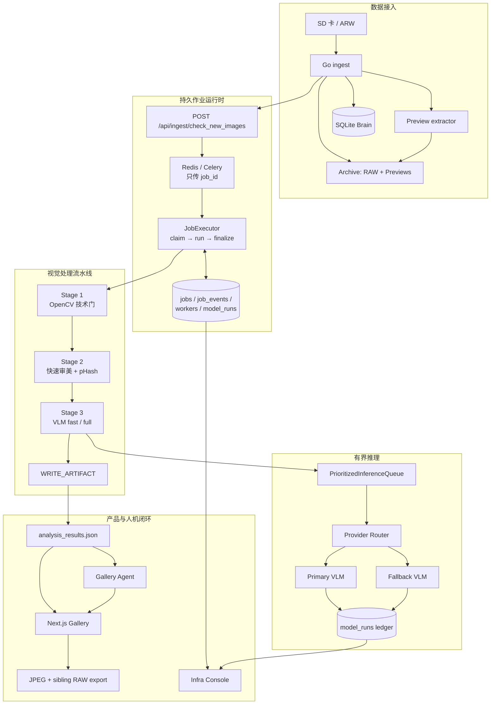

# Livehouse Photography Agent：项目能力、技术设计与评测全景

> 更新时间：2026-08-10  
> 文档范围：当前仓库工作树、已落地运行路径、离线评测产物与明确标注的架构提案。  
> 阅读约定：本文严格区分 **已实现**、**实验中**、**规划中**，不把 Showcase、模拟数据或设计文档中的目标能力描述成生产事实。

---

## 1. 执行摘要

Livehouse Photography Agent（产品名 LumaKernel）是一个面向现场演出摄影师的智能选片与交付工作流。它解决的不是单张图片“能否被 AI 打分”，而是完整处理链条中的工程问题：

```text
拍摄
→ 从 SD 卡导入 RAW
→ 提取预览 JPEG
→ 技术质量检测
→ 审美与语义分析
→ 连拍去重
→ 人工审片
→ 风格处理
→ 预览图与 RAW 配对导出
```

项目的核心由四部分组成：

1. **可靠的数据接入与作业运行时**：Go 负责 SD 卡扫描、原子复制和入库；Python、Celery、Redis 与 SQLite 负责可恢复的长任务执行。
2. **分层视觉处理流水线**：OpenCV 技术门禁、快速审美评估、pHash 去重和 VLM 深度分析组成成本逐级升高的处理漏斗。
3. **摄影师审片闭环**：Next.js Gallery 支持浏览、筛选、人工确认、胶片风格和 RAW 配对导出。
4. **基于产物的 Gallery Agent**：Agent 不重新给图片打分，而是在 `analysis_results.json` 和 Gallery 状态之上搜索、初选、应用风格、导出和记忆偏好。

从系统设计角度，这个项目更准确的定位是：

> 一个以摄影工作流为业务负载、以持久作业和有界 VLM 推理为基础的单节点视觉 AI runtime。

它不是通用聊天机器人，也不是已经完成多租户与分布式改造的平台产品。

---

## 2. 项目解决的真实问题

### 2.1 业务背景

Livehouse 摄影具有几个明显特点：

- 单场拍摄通常产生数百到数千张照片。
- 同一动作会产生大量近似连拍。
- 舞台光复杂，欠曝、彩色染光、烟雾和运动模糊不一定是废片。
- 技术清晰不代表值得交付；主体状态、动作峰值、遮挡和情绪同样重要。
- 预览 JPEG 用于快速审片，最终交付又需要找到对应 RAW。
- VLM 单图推理昂贵、缓慢且可能超时，不能无界并发调用。

因此，简单的“遍历目录并调用 VLM”无法解决：

1. Worker 崩溃后如何恢复？
2. 同一个任务被重复投递时如何避免重复执行？
3. 哪些图片值得消耗 VLM 推理预算？
4. 主模型超时后是否降级到备用模型？
5. 每次模型调用的耗时和成本如何归因？
6. 自动筛选是否真的优于简单规则？
7. 如何保证 Agent 不编造不存在的图片文件名？

### 2.2 产品目标

项目希望形成从导入到发布的完整闭环：

```text
Livehouse night
→ Ingest
→ Analyze
→ Curate
→ Style
→ Export
→ Publish-ready gallery
```

主要产品界面包括：

- **Studio**：提交和浏览拍摄场次。
- **Gallery**：审片、人工反馈、风格预览和导出。
- **ChatDock**：通过自然语言操作当前 Gallery。
- **Infra Console**：查看 job、worker、模型调用、成本和故障。
- **Eval**：展示固定评测集和版本化实验结果。

---

## 3. 当前能力边界

| 能力 | 当前状态 | 说明 |
|---|---|---|
| SD 卡 RAW 增量导入 | 已实现 | Go ingest 推荐路径 |
| RAW 原子归档与 SQLite 登记 | 已实现 | `.partial` 写入后原子 rename |
| 预览 JPEG 提取 | 已实现 | `cmd/preview-extractor/` |
| 持久作业、重试、dead-letter | 已实现 | SQLite jobs 为 SSOT |
| OpenCV 技术检测 | 已实现 | Stage 1 |
| 快速审美、软门禁、pHash 去重 | 已实现 | Stage 2，不是 VLM |
| VLM 快速/完整分析 | 已实现 | Stage 3 `fast_first` |
| Semantic gate | 实验中 | 当前配置为 observe，不应描述为生产硬拒绝 |
| Gallery 审片与初选 | 已实现 | curation JSON |
| 胶片风格与 RAW 配对导出 | 已实现 | 大批量可走 Celery |
| Gallery Agent | 已实现 | 规则路由 + LangGraph + skills |
| 独立 `lumakernel/` 七阶段修图包 | 规划中 | `LUMAKERNEL_ARCHITECTURE.md` 是提案 |
| Critic 有界修图回环 | 规划中 | 当前没有完整 Scene→EditPlan→Critic 实现 |
| 多节点 Postgres / 对象存储 | 未实现 | 仍是单节点 SQLite + 本地路径 |
| 集群级 GPU 配额与多租户隔离 | 未实现 | 当前背压主要在进程内 |

---

## 4. 总体架构



### 4.1 技术栈

- Python 3.10+：核心流水线、FastAPI、Celery、Agent 和评测。
- Go 1.22：SD 卡接入、ARW 归档和预览提取。
- TypeScript / React / Next.js：Studio、Gallery、Infra、Eval 和 ChatDock。
- OpenCV：技术质量、快速审美辅助和图像特征。
- Ollama / vLLM / OpenAI-compatible：VLM 和 Agent 模型后端。
- Redis / Celery：任务通知与 worker 调度。
- SQLite：作业、事件、worker 和模型调用的单节点事实源。

---

## 5. 数据接入设计

### 5.1 推荐生产路径：Go SD / Brain 模式

Go ingest 的职责边界非常清晰：**只负责发现、归档和登记，不负责图像分析**。

```text
SD 卡
→ 并发扫描 ARW
→ 批量读取 EXIF CreateDate
→ 按日期划分 session
→ 文件指纹去重
→ 原子复制到 Archive/session/RAW
→ SQLite photos/sessions 入库
→ 提取 Preview JPEG
→ 更新 runtime/latest_session.json
→ 通知 Python API
```

关键实现：

- `cmd/ingest/main.go`
- `cmd/ingest/ingest_sd_brain.go`
- `cmd/ingest/luma_brain.go`
- `cmd/preview-extractor/`
- `cmd/ingest/luma_brain_schema.sql`

### 5.2 原子复制

RAW 文件不是直接复制到最终文件名，而是：

```text
写入 dest.partial
→ fsync
→ rename 到最终路径
```

这样即使中途断电，也不会留下一个看似完整但内容损坏的 RAW 文件。数据库事务失败时，会回滚并清理已经复制的文件。

### 5.3 文件指纹的工程取舍

当前指纹主要基于：

```text
文件名 + 文件大小 + 修改时间
```

优点：

- 不读取整张 RAW，扫描成本低。
- 同一张卡反复扫描时几乎没有额外磁盘吞吐。

代价：

- 理论上不同文件可能出现相同名称、大小和时间戳。
- 这是针对相机 SD 卡场景做出的成本与冲突概率权衡，并非内容级哈希。

### 5.4 Legacy 路径

仓库仍保留归档目录轮询模式，它会直接启动 `run_pipeline.py` 子进程。这条路径绕过完整 jobs 状态机和 HTTP hook，因此适合作为兼容或本地调试路径，不应继续承载新的生产能力。

---

## 6. 持久作业运行时

### 6.1 为什么 Celery 不是事实源

Celery 和 Redis 只负责把 `job_id` 交给 worker：

```text
tasks.run_job(job_id)
```

任务是否可以执行、执行到哪一步、是否需要重试，以 SQLite 中的 `jobs` 和 `job_events` 为准。

这样设计的原因：

- Celery 是 at-least-once 投递，任务可能重复到达。
- Worker 可能在推理过程中崩溃。
- API、Infra Console 与 worker 需要看到同一个状态。
- 任务重派发后，旧 worker 不能覆盖新 generation 的数据库终态；artifact 发布还会
  使用 session 级文件锁、原子 rename 和发布前后 claim fence 检查。

### 6.2 JobExecutor

主路径：

```text
tasks.run_job
→ JobExecutor.run(job_id)
→ worker heartbeat
→ transactional claim
→ PipelineStageRunner
→ finalize / retry / dead-letter
```

关键文件：

- `tasks/run_job.py`
- `services/job_executor.py`
- `services/job_lifecycle.py`
- `infra/worker_manager.py`
- `utils/luma_brain.py`

### 6.3 Claim 与幂等

JobExecutor 在运行前执行原子 claim。只有符合 runnable 状态的 job 才能从队列态进入 claimed 状态。

重复投递时：

- 第一个 worker claim 成功。
- 第二个 worker claim 失败并跳过。

这种设计把“是否真的开工”从消息队列转移到数据库事务。

### 6.4 Claim fence

Worker 崩溃或心跳过期后，系统可以重新派发 job。为了防止旧 worker 稍后恢复并写入
过时状态，executor 的 progress/terminal 更新会校验 claim generation 和 worker id。
生成的 gallery 文件逐文件原子发布，WRITE_ARTIFACT 还会在 session 文件锁内检查 claim；
这避免 partial file 和并发 publisher 覆盖，但不等同于跨数据库与文件系统的事务。

```text
旧 generation 写结果
→ ClaimFenceError
→ 禁止覆盖新 generation
```

这是作业系统中处理“僵尸 worker”的关键设计。

### 6.5 状态机与失败分类

概念状态包括：

```text
QUEUED / FAILED_RETRYABLE
→ CLAIMED
→ PREPROCESSING
→ INFERENCING
→ POSTPROCESSING
→ SUCCEEDED
```

失败路径包括：

- `FAILED_RETRYABLE`
- `FAILED_PERMANENT`
- `DEAD_LETTERED`
- `CANCELLED`

错误分类、重试和 dead-letter 由生命周期层处理，而不是散落在每个图像阶段内部。

---

## 7. 图像处理流水线

### 7.1 当前生产阶段

```text
PREPARE_INPUT
→ STAGE1_FILTER
→ STAGE2_FAST_SCORE
→ STAGE3_VLM
→ WRITE_ARTIFACT
→ FINALIZE
```

主实现位于：

- `services/processor/pipeline_stage_runner.py`
- `services/processor/pipeline_image_ops.py`
- `engine/operators/stage2_prefilter.py`
- `services/processor/stages/deep_analysis.py`

### 7.2 中间状态与 checkpoint

中间状态写入：

```text
Previews/.luma_pipeline_staged/
├── eligible_after_stage1.jsonl
└── eligible_after_stage2.jsonl
```

逐图审计结果写入：

```text
Previews/aesthetic_audit.jsonl
```

同一图片可能因为重试产生多行，读取时以最后一行为准。VLM 不可达造成的 placeholder 会被识别为可重试结果，不会被当成真实评分永久跳过。

### 7.3 Stage 1：OpenCV 技术门

Stage 1 负责低成本、相对客观的技术检查，包括：

- Laplacian 方差清晰度。
- Sobel 梯度方向不对称，用于运动模糊辅助判断。
- 过曝与欠曝比例。
- 对比度。
- 边缘比例。
- 基础内容有效性。

设计上，Stage 1 不应直接替代摄影语义判断。Livehouse 中的运动、烟雾、剪影和极暗画面可能是艺术表达，因此当前策略倾向于：

- 只 hard reject 明确技术失败。
- 将模糊边界样本交给后续阶段。
- 保留技术分和诊断信息供最终融合。

### 7.4 欠曝 salvage lane

传统曝光规则容易误杀“很暗但仍有结构”的舞台照片。项目增加了欠曝补救路径：

1. 判断暗部是否仍有边缘和对比结构。
2. 在内存中生成 EV 补偿预览。
3. 检查补偿后是否恢复可用细节。
4. 对技术分和 Stage 2 门槛提供有限 rebate。
5. VLM 仍看原始图像，不把补偿预览当成真实曝光。

这个设计试图区分：

- 真正没有信息的死黑废片。
- 可通过 RAW 后期恢复的低照度照片。

### 7.5 Stage 2：快速审美、软门禁与去重

Stage 2 不是 VLM。它在单次图像解码上组合：

- 快速审美分。
- 人脸和主体代理特征。
- 构图代理特征。
- pHash。
- 技术分与快速审美分融合门槛。
- ambiguous tags。

Livehouse 域策略是：

- 严重无结构模糊、极端过曝可以 hard reject。
- 运动模糊、无人脸、密集人群、亮区主体弱等情况优先标记为 ambiguous。
- ambiguous 候选预留 VLM 配额，而不是在廉价阶段直接删除。

### 7.6 Stage 2 pHash 去重

Stage 2 对候选做感知哈希聚类，默认每个近重复 cluster 保留有限数量代表帧。

目的不是永久删除照片，而是减少后续 VLM 推理浪费：

```text
同一连拍 20 张
→ Stage 2 聚类
→ 保留少量代表帧进入 VLM
```

### 7.7 Stage 3 准入门控

Stage 3 的准入综合考虑：

- Stage 2 分数。
- 分位数阈值。
- Top-K 比例。
- 最大候选数。
- ambiguous reserve。
- 队列压力和降级策略。

因此 VLM 预算优先分配给：

- 高分候选。
- 明显有潜力的照片。
- 传统特征无法可靠判断的 Livehouse 特殊样本。

---

## 8. Stage 3 VLM 设计

### 8.1 Fast-first 双模推理

当前 Stage 3 支持 `fast_first`：

```text
候选图片
→ Fast VLM
→ 聚合分、标签、情绪、语义缺陷观测
→ 规则判断是否需要 Full VLM
→ 完整八维评分与解释
```

Fast pass 输出：

- `score`：0–100。
- `verdict`：中英双语。
- `tags`。
- `mood_tags`。
- `semantic_gate` observation。

Full pass 输出八维评分：

1. `focus_sharpness`
2. `exposure_control`
3. `noise_cleanliness`
4. `composition_framing`
5. `light_color_character`
6. `moment_peak`
7. `atmosphere_impact`
8. `deliverable_subject`

并附带：

- 最强项与最弱项。
- 双语评论。
- 标签与情绪标签。
- 可选编辑建议。

### 8.2 结构化输出与兼容层

VLM 输出先经过 Pydantic schema：

- 数值范围约束。
- 缺失字段默认值。
- 中英双语字段归一。
- 标签清洗。
- Semantic observation 校验。

然后通过 `to_parsed_dict()` 转换成现有下游依赖的 dict 结构。

这个设计允许逐步引入强类型验证，同时保持 `analysis_results.json` 等历史下游契约稳定。

### 8.3 动态权重

默认八维权重均衡，但艺术运动模糊场景可以使用不同权重：

- 降低绝对清晰度权重。
- 提高动作峰值和现场氛围权重。

这体现了一个重要领域判断：

> 摄影质量不能完全等价于技术清晰度，某些技术“不完美”可能服务于情绪表达。

### 8.4 分数融合

最终分数可融合：

```text
VLM / AI score × 0.8
+ OpenCV technical score × 0.2
```

技术分提供稳定底座，VLM 负责构图、瞬间和语义价值。但最新评测显示当前总分存在明显过度评分，权重与校准仍需要在独立开发集上优化。

---

## 9. Semantic gate：观测与策略解耦

语义废片包括：

- 严重遮挡。
- 闭眼或表情失败。
- 无明确主体。
- 错过动作峰值。
- 严重构图失败。
- 无效姿态等。

项目没有直接让 VLM 输出“删除/保留”并无条件执行，而是拆成两层：

### 9.1 模型观测

```json
{
  "is_present": true,
  "types": ["heavy_occlusion"],
  "severity": 2,
  "confidence": 0.91,
  "evidence": "主体面部被前景手臂大面积遮挡"
}
```

### 9.2 Python 确定性策略

`services/processor/stages/semantic_gate.py` 根据：

- 缺陷类型。
- 严重程度。
- 置信度。
- 是否存在具体证据。
- 主观型和相对客观型缺陷的不同门槛。

生成：

```text
pass / reject / review / unknown / disabled
```

支持模式：

- `off`
- `observe`
- `soft`
- `hard`

当前工作树配置方向是先 observe，再根据 dev set 评测决定是否升级。这是“证据生成”和“产品策略”解耦的典型做法。

需要诚实说明：最新冻结集 baseline 中，semantic gate recall 只有 2%，因此它当前不能被描述为已经可靠解决语义废片问题。

---

## 10. 有界 VLM 推理

### 10.1 为什么不能直接开线程并发调用 Ollama

视觉模型在本地后端通常受显存、统一内存和视觉 token buffer 限制。提高 Python 线程数不等于提高模型吞吐，可能只会：

- 在 Ollama 内部继续排队。
- 增加尾延迟。
- 引发 OOM。
- 让所有任务同时超时。

当前默认配置对 `qwen2.5vl:7b` 使用非常保守的单并发。

### 10.2 PrioritizedInferenceQueue

`inference/queue.py` 提供：

- 优先级队列。
- 每模型 lane。
- worker 数限制。
- `BoundedSemaphore` 准入。
- 最大队列长度。
- queue wait timeout。
- 可选 batch 聚合窗口。
- 周期性队列指标。
- shutdown 时拒绝尚未执行的任务。

### 10.3 Primary / fallback 与账本

推理请求通过 router 发送到 provider：

```text
primary
→ timeout / error
→ fallback
```

每次 attempt 写入 `model_runs` 和 attempts ledger，包括：

- provider。
- model。
- queue wait。
- inference latency。
- 成功或错误类型。
- token 用量。
- 是否 degraded。

因此，系统可以区分：

- 主模型成功。
- 主模型失败、备用成功。
- 队列等待超时。
- provider 调用失败。

### 10.4 当前边界

- 队列主要是单进程内背压，不是全局 GPU 调度器。
- 取消 job 不保证立即中断已经在飞的 HTTP 请求。
- 多实例 lane 和多 Ollama endpoint 仍需要实际硬件容量验证。

---

## 11. 产物与 Gallery 数据契约

### 11.1 物理分级目录

根据最终分数和策略，预览图被复制到：

```text
AI_Best_90+
AI_Keep_60-90
AI_Trash_Below60
```

### 11.2 `aesthetic_audit.jsonl`

它保留更完整的逐图处理历史，包括：

- 技术分和 debug 信息。
- VLM 分数与八维结果。
- 中英双语理由。
- tags / mood tags。
- Semantic gate。
- Stage 3 metadata。
- 编辑建议。
- checkpoint / fallback 状态。

### 11.3 `analysis_results.json`

这是 Gallery 和 Agent 的主要消费视图，典型字段包括：

```json
{
  "file": "DSC_1234.jpg",
  "path": "AI_Keep_60-90/DSC_1234.jpg",
  "category": "keep",
  "overall_score": 82.4,
  "dimensions": {
    "moment_peak": 9.1,
    "atmosphere_impact": 8.4,
    "deliverable_subject": 8.7
  },
  "tags": ["吉他手", "现场演出"],
  "mood_tags": ["热烈"],
  "reason_bilingual": {
    "zh": "主体动作处于演奏峰值",
    "en": "The subject is captured at a peak performance moment."
  },
  "semantic_gate": {
    "status": "pass",
    "mode": "observe"
  }
}
```

需要注意：

- 它是 Gallery 优化后的消费视图，不等于完整处理历史。
- 被早期 gate 或去重跳过的图片可能没有完整 Stage 3 行。
- Agent 只基于这里已有的数据工作，不会自动重新运行 Stage 3。

---

## 12. Gallery、人工反馈与导出

### 12.1 Gallery

Gallery 提供：

- 分数和分类浏览。
- 搜索和排序。
- 近重复折叠。
- 人工 liked / pass / rejected。
- 单张方向修正。
- 胶片风格预览。
- 预览 JPEG 和对应 RAW 导出。

### 12.2 人工选片状态

人工反馈写入 runtime 下的 `gallery_curation.json`：

```json
{
  "version": 2,
  "selected_keys": ["DSC_1234.jpg"],
  "feedback_by_key": {
    "DSC_1234.jpg": {
      "verdict": "liked"
    }
  },
  "export_by_file": {}
}
```

它将模型分析结果与摄影师最终判断分开：

- `analysis_results.json`：机器分析。
- `gallery_curation.json`：人工选择和交付状态。

### 12.3 多层去重

项目存在三个不同目标的去重层：

| 层 | 目的 | 是否删除磁盘图片 |
|---|---|---|
| Stage 2 pHash | 减少 VLM 调用 | 否 |
| Stage 3 cache | 复用相似图推理结果 | 否 |
| Gallery view dedupe / diversity | 减少浏览重复、提升展示多样性 | 否 |

将“计算成本去重”和“摄影师浏览体验去重”分开，可以避免为了省推理而永久删除有后期价值的连拍帧。

### 12.4 RAW 配对导出

导出逻辑根据预览 basename 查找 sibling `RAW/` 中的源文件，输出：

- 预览 JPEG。
- RAW。
- 可选从 RAW 开发并应用胶片风格的高质量 JPEG。

大批量导出可以交给 Celery，避免长时间占用 HTTP 请求。

---

## 13. Gallery Agent 技术设计

### 13.1 Agent 的边界

Agent 服务当前拍摄场次，可以：

- 搜索照片。
- 查看统计。
- 解释某张照片。
- 标记初选。
- 推荐或应用胶片风格。
- 导出选中照片。
- 记忆用户偏好。

Agent 不负责：

- 重新运行 Stage 1–3。
- 重新给全场照片打分。
- 通用联网搜索。
- 任意 Python 代码执行。
- 跨场次知识库问答。

### 13.2 混合运行时

当前 Agent 是混合架构：

```text
用户请求
→ Guardrails
→ intent_router
   ├── 命中高频正则：固定 RouteMatch
   └── 未命中：LangGraph decide → act → answer
→ grounded final answer
```

高频路由包括：

- 选出 N 张。
- 去重。
- 排除模糊/过曝。
- 社交媒体配方。
- 最炸/高潮瞬间。
- 胶片风格。

未命中的开放语义请求进入 LangGraph：

```text
START
→ decide
→ act
→ decide
→ answer
→ END
```

默认最多 3 个工具轮次，并通过 `seen_keys` 防止重复调用。

### 13.3 Skills

Gallery registry 包含：

- `gallery_search`
- `gallery_stats`
- `explain_photo`
- `gallery_select`
- `recommend_film_for_photo`
- `apply_film_vibe`
- `export_selected`
- `mark_score_gap`
- memory skills

### 13.4 Gallery 搜索

搜索组合：

1. tags / mood tags / caption / reason 子串匹配。
2. 中英文同义词扩展。
3. 可选 CLIP 文本到图片召回。
4. 配方维度重排。
5. 连拍去重。

内置配方包括：

- `shortlist`
- `social`
- `energy`
- `peak`
- `deliverable`
- `quality`
- `dedupe`
- `sort`

### 13.5 三层记忆

| 层 | 内容 | 持久化 |
|---|---|---|
| Conversation memory | 最近 user / assistant / tool 消息 | SQLite |
| Working memory | `last_query`、`last_files`、最近工具 | SQLite conversation |
| Preferences | 用户显式偏好 | SQLite preferences |

LangGraph 本身没有 checkpointer；能跨 HTTP 恢复的是对话和工作记忆，不是某次图执行到一半的节点状态。

### 13.6 Groundedness

为了防止模型编造 `DSC_xxxx.jpg`，最终回答阶段不直接把真实文件名交给模型引用，而是生成：

```text
{ref_0}
{ref_1}
```

模型只能使用这些占位符。随后代码：

1. 将占位符解析为真实文件名。
2. 检查所有文件名是否来自工具结果。
3. 如果存在未知文件名，丢弃自由文本。
4. 使用确定性模板重写回答。

这个设计比“发现幻觉文件名后简单删除”更安全，因为删除字符串可能留下语义错误的句子。

### 13.7 Guardrails

Guardrails 覆盖：

- 用户输入注入检测。
- 不可信工具输出围栏。
- 输出长度和敏感内容检查。
- observe / soft / hard 策略。

Gallery 自有数据库输出默认视为可信，因此不加重型 untrusted fence，但仍做注入扫描。

---

## 14. Agent 当前设计问题：规则路径与 Agent 路径

以请求：

```text
帮我选10张最有张力的吉他手照片发小红书
```

为例，当前代码会命中 `shortlist_select`，固定执行：

```text
gallery_search
→ gallery_select
→ LLM 总结
```

这条路径中，LLM 没有决定工具和选片策略。

当前实际问题包括：

- “小红书”没有命中 social 配方。
- “张力”没有命中 energy 或 peak 配方。
- residue 清洗会把“张力”拆成“有 力”。
- 最终按 `overall` 排序，而不是明确按 `moment_peak` 或 `atmosphere_impact`。
- 规则只能保证最多 10 张，不能保证合格候选恰好有 10 张。

因此，当前系统更准确地说是：

> 规则驱动的高频工具工作流 + LangGraph 语义兜底 + 确定性图片检索执行器。

下一步更合理的设计不是无限扩张正则，也不是训练一个模糊的“规则/Agent”二分类器，而是：

```text
规则提取确定字段
  action=select
  count=10

LLM 解释开放语义
  subject=guitarist
  ranking_intent=visual_tension
  platform=xiaohongshu

确定性执行器
  filter → rank → dedupe → select
```

---

## 15. 项目中有深度的设计点

### 15.1 消息队列与执行事实分离

Celery 只传 `job_id`，SQLite transaction claim 才代表真正开始执行。这使重复投递、worker 崩溃和 stale worker 都有明确语义。

### 15.2 逐层增加成本的视觉漏斗

```text
OpenCV
→ 快速审美
→ pHash 去重
→ Stage3 准入
→ Fast VLM
→ 稀疏 Full VLM
```

不是所有照片都值得支付同样的推理成本。

### 15.3 领域不确定性显式进入系统

运动模糊、烟雾、剪影和无人脸不直接等于废片，而是进入 `ambiguous_tags` 和预留候选槽。这比套用普通人像质量规则更符合 Livehouse 摄影。

### 15.4 模型观测与产品决策分离

Semantic gate 中，VLM 只提供证据，Python 策略决定 pass/review/reject。这让阈值、风险偏好和上线模式可以独立演进。

### 15.5 双产物视图

- `aesthetic_audit.jsonl`：完整处理与审计事实。
- `analysis_results.json`：Gallery 和 Agent 使用的消费视图。

这种分离避免为了 UI 简洁而丢失调试和恢复所需信息。

### 15.6 推理背压闭环

队列深度、等待延迟和模型容量不仅用于监控，也可以驱动 Stage 3 trim 或降级，避免过载时把整个 worker 拖死。

### 15.7 Groundedness 作为结构化产品契约

文件名真实性不是依赖 Prompt，而是通过工具 metadata、引用索引和确定性模板保障。

### 15.8 人机协作而非全自动替代

流水线产出机器分析，Gallery 保存摄影师决策。系统支持初选和建议，但最终交付仍有人工确认位置。

---

## 16. 评测体系

### 16.1 评测哲学

项目将两个风险置于总体 Accuracy 之前：

1. **废片入选**：已知技术或语义废片进入最终交付结果。
2. **好片误杀**：普通或高光照片在早期被错误过滤。

由于测试集是人工平衡的，不应用总体 Accuracy 推算线上真实废片率。

评测分六层：

```text
数据完整性
→ Stage 1 技术门
→ Semantic gate
→ 串联流水线
→ Top-K 选片
→ Agent 协议、稳定性和成本
```

### 16.2 `selection_v1` 冻结集

`selection_v1` 已于 2026-08-10 冻结：

| 类别 | 数量 | 目标 |
|---|---:|---|
| `technical_hard` | 50 | Stage 1 技术废片召回 |
| `semantic_defect` | 50 | 语义废片召回 |
| `ordinary` | 100 | 防止误杀普通片 |
| `highlight` | 50 | 高光保护与 Top-K |
| 合计 | 250 | 覆盖 21 个场次 |

数据集 SHA-256：

```text
7e684c0d89dd3601b23b7118c003dbfeb89cd431f14dbbd9a875424345c805b6
```

冻结产物包括：

```text
data/eval/selection_v1/
├── labels.jsonl
├── defects.json
├── acceptable_pool.json
├── manifest.json
├── orientation_review.json
├── frozen_manifest.json
├── pack_manifest.json
└── freeze.json
```

### 16.3 图像方向协议

250 张图片均经过人工方向复核：

- 无需额外旋转：117 张。
- 顺时针 270°：133 张。

评测必须统一执行：

```text
读取图像
→ EXIF transpose
→ orientation_correction_degrees
→ 输入 OpenCV / VLM
```

忽略方向字段的结果视为无效。

### 16.4 测试集纪律

冻结测试集只能用于：

- 建立候选 baseline。
- 候选版本验收。
- 正式回归。
- 最终报告。

不能用于：

- 搜索阈值。
- 反复修改 Prompt 直到通过。
- 根据失败图片编写特例。

阈值、Prompt 和模型选择应在独立 dev set 上完成。当前 candidate rounds 和 semantic gate dev 数据可承担部分开发集职责，但仍需要未来独立的 `selection_v2` hidden holdout。

### 16.5 核心指标

#### Stage 1

```text
Technical Recall
Technical FNR
Ordinary FPR
Highlight FPR
按技术原因分组的 Recall
```

发布门槛：

- Technical Recall ≥ 96%。
- Ordinary FPR ≤ 5%。
- Highlight FPR ≤ 2%。

#### Semantic gate

分别计算：

- Intrinsic：绕过 Stage 1。
- Production：只看 Stage 1 放行样本。

发布门槛：

- Semantic Recall ≥ 90%。
- Ordinary FPR ≤ 5%。
- Highlight FPR ≤ 2%。

#### Top-K

Zero Blunder：

```text
Top-K 非空
AND 已知废片数 = 0
```

Overlap@K：

```text
|selected_top_k ∩ acceptable_pool| / K
```

要求：

- Global Top-10 废片数为 0。
- Global Overlap@10 ≥ 0.80。
- 每个 Pack Top-5 废片数为 0。
- Macro Pack Overlap@5 ≥ 0.80。

#### 评分诊断

- Spearman。
- MAE / RMSE。
- Mean Bias。
- 八维 MAE 与 Spearman。

评分相关性是辅助指标，不能替代 Zero Blunder 和 Recall。

### 16.6 固定图包

冻结集被确定性拆为 10 个互不重叠的 pack，每包：

| 类别 | 数量 |
|---|---:|
| 技术废片 | 5 |
| 语义废片 | 5 |
| 普通片 | 10 |
| 高光片 | 5 |
| 总计 | 25 |

每包执行 Top-5，防止全局排序的平均值掩盖某个场景严重失败。

---

## 17. 最新 `selection_v1` 实测结果

### 17.1 结果身份

Full VLM 候选 baseline：

- Run ID：`20260810T124922Z`
- Git commit：`752dd89828edc7ddff9eaaec75f6089219534c93`
- Model：`qwen2.5vl:7b`
- Mode：`gated_full_vlm`
- 结论：**FAIL，不具备 release eligibility**

报告位置：

```text
reports/eval/selection_v1/full_vlm_baseline/
```

### 17.2 核心结果

| 指标 | 实测 | 目标 | 结果 |
|---|---:|---:|---|
| Stage 1 Technical Recall | 82.0% | ≥96% | FAIL |
| Semantic gate Recall | 2.0% | ≥90% | FAIL |
| Pipeline defect Recall | 43.0% | — | 诊断 |
| Global Top-10 废片 | 0 | 0 | PASS |
| Global Overlap@10 | 40.0% | ≥80% | FAIL |
| Macro Pack Overlap@5 | 36.0% | ≥80% | FAIL |
| Pack 选中废片 | 3/50 | 0 | FAIL |

### 17.3 Stage 1

混淆计数：

```text
TP=41
FN=9
FP=1
TN=199
```

优点：

- Precision 约 97.6%。
- 普通片误杀率约 1%。
- 高光片误杀为 0。

问题：

- 技术废片仍漏掉 9/50。
- 总召回 82%，距离 96% 门槛明显不足。

按原因：

| 原因 | Recall |
|---|---:|
| excessive_noise | 93.3% |
| out_of_focus | 87.0% |
| poor_exposure | 87.5% |
| undeliverable_subject | 93.9% |
| technical_failure | 0/2 |

### 17.4 Semantic gate

```text
TP=1
FN=49
FP=1
TN=149
```

这意味着冻结集上几乎所有语义废片都没有被正确拒绝。

细分问题：

- `heavy_occlusion`：约 3.6%。
- `missed_moment`：4%。
- `no_clear_subject`：0%。
- `severe_composition_failure`：0%。

Dev 集上曾出现更高结果，但 dev 结果不能替代冻结测试集成绩。两者差距说明可能存在：

- 数据分布差异。
- Prompt 或 schema 适配问题。
- Pipeline adapter 与 semantic gate 结果映射问题。
- 开发集污染或难度不足。

### 17.5 Top-K

Global Top-10 没有已知废片，但只命中 acceptable pool 中 4 张，Overlap@10 为 40%。

10 个固定 pack 中：

- 3 个 pack 出现已知废片。
- 50 次 pack 选择共出现 3 张废片。
- Macro Overlap@5 为 36%。
- 最差 pack Overlap@5 为 0。

这说明“全局 Top-10 看起来安全”不能代表不同场次和局部候选包都安全。

### 17.6 分数质量

| 指标 | 结果 |
|---|---:|
| 覆盖样本 | 208/250 |
| Overall Spearman | 0.351 |
| Overall MAE | 12.15 |
| RMSE | 14.98 |
| Mean Bias | +9.95 |
| 过度评分比例 | 79.3% |
| 八维 Macro MAE | 1.342 |

值得关注的八维 Spearman：

| 维度 | Spearman |
|---|---:|
| focus_sharpness | 0.492 |
| moment_peak | 0.454 |
| deliverable_subject | 0.435 |
| noise_cleanliness | 0.392 |
| composition_framing | 0.135 |
| atmosphere_impact | 0.110 |
| light_color_character | 0.144 |
| exposure_control | -0.005 |

主要结论：

- 模型对清晰度、瞬间和主体可交付性有一定排序能力。
- 曝光维度几乎没有排序相关性。
- 总分存在明显偏高。
- 高分排序和人工 acceptable pool 仍有较大差距。

### 17.7 性能

| 指标 | 结果 |
|---|---:|
| VLM calls | 208 |
| p50 latency / image | 约 138 秒 |
| p95 latency / image | 约 144 秒 |
| p99 latency / image | 约 265 秒 |

这些结果进一步说明有界推理、前置门控和缓存并非可选优化，而是本地 VLM 工作流的必要组成。

---

## 18. 其它评测

### 18.1 Stage 1-only baseline

Stage 1-only 报告同样为 FAIL：

- Technical Recall：82%。
- Global Overlap@10：80%。
- Macro Pack Overlap@5：32%。
- 多个 pack 出现语义废片。

它说明单靠技术分可能在全局 Top-10 上偶然获得较高 overlap，但无法安全处理语义废片。

### 18.2 历史 Stage 3 评测

旧数据集曾记录：

- Spearman 约 0.537。
- MAE 约 12.04。
- Macro dimension MAE 约 1.46。

README 还记录过其它历史实验数字。由于旧数据集、标签生成方式和协议与 `selection_v1` 不同，不能直接严格同比。

### 18.3 独立 Agent 评测

Agent 评测目前由独立 harness 覆盖：

- 路由 paraphrase。
- 工具调用正确性。
- 文件名真实性。
- Groundedness。
- 工具轮数。
- 延迟和 token。
- Mock / live case。

已有独立 Agent baseline：

- 3 个 smoke cases。
- Overall score 约 89.31。
- Workflow 3/3。

Weekly L0 快照曾记录：

- Chat cases 33/33。
- Router paraphrases 54/54。
- Live mock pass@1 = 1.0。

但是这些结果评估的是小规模协议和行为契约，不能证明 Agent 在 `selection_v1` 的 250 张图片上具有发布级选片质量。

当前 `selection_v1` runner 尚未把 Agent 端到端稳定性和 10 个 pack 完整串联。

### 18.4 评测基础设施

仓库已经建立：

- 冻结 join key 与 score scale。
- Dataset manifest。
- Prompt / model / workflow / code 版本指纹。
- Eval run schema。
- Baseline diff。
- 错误案例 JSONL。
- 可视化错误 gallery。
- Wilson 95% CI。
- 逐层错误归因。

关键目录：

- `quality/`
- `agent_eval/`
- `scripts/eval/`
- `data/eval/`
- `reports/eval/`

---

## 19. 当前最重要的问题

### P0：发布安全

1. Pack Zero Blunder 未通过，50 次选择中进入 3 张已知废片。
2. Semantic gate 在冻结集上只召回 1/50。
3. 当前候选 baseline 未批准，不应作为 release baseline。

### P1：视觉质量

1. Stage 1 技术召回 82%，低于 96%。
2. Global 和 Macro Pack Overlap 明显不足。
3. 总分平均高估约 10 分。
4. 曝光、氛围和构图维度排序相关性弱。

### P1：Agent 语义理解

1. 高频整句硬路由会跳过 Agent 规划。
2. 中文 paraphrase 覆盖依赖正则维护。
3. “小红书”“张力”等开放语义没有结构化目标。
4. 搜索 OR 召回不能严格保证主体约束。

### P2：系统工程

1. SQLite 是单节点 SSOT。
2. 推理背压不是集群级配额。
3. 本地产物路径要求 API、worker 和前端共享文件系统语义。
4. Legacy ingest 仍绕过 jobs。
5. 已在飞的 VLM HTTP 请求不能被立即取消。

### P2：文档与实现边界

`docs/LUMAKERNEL_ARCHITECTURE.md` 描述的独立 `lumakernel/` 包、EditPlan 和 Critic 回环尚未完整落地。当前生产能力应以 `services/processor/`、`services/agent/` 和 Gallery 路径为准。

---

## 20. 建议的下一步

### 20.1 先修评测闭环，而不是直接调冻结集

1. 保持 `selection_v1` 只用于验收。
2. 用 candidate rounds 和 semantic gate dev set 做 Prompt、schema 和阈值开发。
3. 查清 semantic dev 93% 与冻结集 2% 的断层。
4. 修复后以相同协议重新生成候选 baseline。
5. 未通过 Zero Blunder 前，不批准发布 baseline。

### 20.2 Stage 1

1. 分析 9 个 technical FN 的共同特征。
2. 检查方向、decode、曝光 salvage 和阈值适配。
3. 不以提高召回为由牺牲 Highlight FPR。
4. 所有修改先在 dev set 做分层 Recall/FPR。

### 20.3 Semantic gate

1. 验证 VLM 是否真实输出 semantic observation。
2. 检查 parser、Pydantic schema 和 pipeline adapter 是否丢字段。
3. 将 observation 缺失、低置信度和明确无缺陷分别统计。
4. observe 模式达到稳定指标后再考虑 soft/hard。
5. 主观类缺陷保持更高拒绝门槛。

### 20.4 Agent

将当前整句级路由改为字段级规划：

```text
确定性 parser
→ action / count / explicit filters

LLM semantic planner
→ subject / mood / ranking intent / platform

deterministic executor
→ search / rank / dedupe / select
```

同时把 `selection_v1` pack 接入 Agent E2E：

- 每个 prompt 运行 3 次。
- 报告 Zero Blunder。
- 报告 Overlap@K。
- 报告 Jaccard 稳定性。
- 报告幻觉文件名、重复、空结果和工具轨迹。

### 20.5 Runtime

1. 逐步淘汰 legacy ingest mode A。
2. 继续保持 Ollama vision 单并发，除非压测证明硬件可承受。
3. 完善 queue wait、provider latency 和总延迟分解。
4. 未来需要多节点时，再实施 Postgres、对象存储和集群级 GPU 配额。

---

## 21. 推荐阅读路径

### 主业务路径

1. `README.md`
2. `docs/PROJECT_GUIDE.txt`
3. `tasks/run_job.py`
4. `services/job_executor.py`
5. `services/processor/pipeline_stage_runner.py`
6. `services/processor/stages/deep_analysis.py`
7. `inference/queue.py`

### Gallery 与 Agent

1. `api/gallery_routes.py`
2. `services/processor/reporting/gallery_integration.py`
3. `api/agent_routes.py`
4. `services/agent/conversation.py`
5. `services/agent/conversation_graph.py`
6. `services/agent/skills/gallery_search.py`
7. `services/agent/groundedness.py`
8. `docs/AGENT_SLIM.txt`

### 评测

1. `reports/eval/selection_v1_quality_evaluation_plan.md`
2. `configs/eval/selection_v1.yaml`
3. `scripts/eval/run_selection_quality_eval.py`
4. `agent_eval/scorers/pipeline_quality.py`
5. `reports/eval/selection_v1/full_vlm_baseline/report.json`
6. `quality/CONTRACTS.md`

### 接入层

1. `docs/GO_INGEST_NOTES.md`
2. `cmd/ingest/main.go`
3. `cmd/ingest/ingest_sd_brain.go`
4. `cmd/ingest/luma_brain.go`

---

## 22. 关键配置

主要配置文件：

```text
configs/livehouse.yaml
```

关键配置块：

- `paths.source_dir`
- `quality_thresholds`
- `fast_aesthetic`
- `model.provider`
- `model.model_name`
- `model.agent_chat_model`
- `model.max_concurrent_requests`
- `model.max_inference_queue_size`
- `model.queue_wait_timeout_seconds`
- `model.fallback_model_name`
- `evaluation.default_weights`
- `classification`
- `processing.underexposure_salvage`
- `processing.stage2_prefilter`
- `processing.gallery_view_dedupe`
- `stage3`
- `stage3.semantic_gate`

重要环境变量：

- `CELERY_BROKER_URL`
- `CELERY_RESULT_BACKEND`
- `LUMA_BRAIN_DB`
- `LUMA_ARCHIVE_ROOT`
- `LIVEHOUSE_GALLERY_PREVIEWS_DIR`
- `LIVEHOUSE_CONFIG`
- `LIVEHOUSE_AGENT_RUNTIME`
- `LIVEHOUSE_AGENT_NATIVE_TOOLS`
- `LIVEHOUSE_AGENT_GUARDRAIL_POLICY`
- `LIVEHOUSE_AGENT_SEMANTIC_FALLBACK`
- `LIVEHOUSE_BRAIN_BACKEND`

---

## 23. 项目的一句话总结

> LumaKernel 不是一个给照片随意打分的聊天机器人，而是一套把 Livehouse 摄影的导入、分析、选片、风格和导出放进可恢复、可观测、可评测运行时中的人机协作系统。

它目前最成熟的部分是：

- 持久作业与执行可观测性。
- 分层图像处理和有界 VLM 推理。
- Gallery 人工审片与 RAW 导出闭环。
- Agent 文件名 groundedness 和工具协议。
- 数据集冻结、错误归因和多层评测框架。

它目前最需要解决的部分是：

- Semantic gate 在冻结集上的泛化失败。
- Stage 1 召回不足。
- Top-K 与人工 acceptable pool 的差距。
- Agent 整句硬路由导致的开放语义丢失。
- 从单节点个人工作流向更可靠部署形态演进时的存储、调度和隔离问题。

